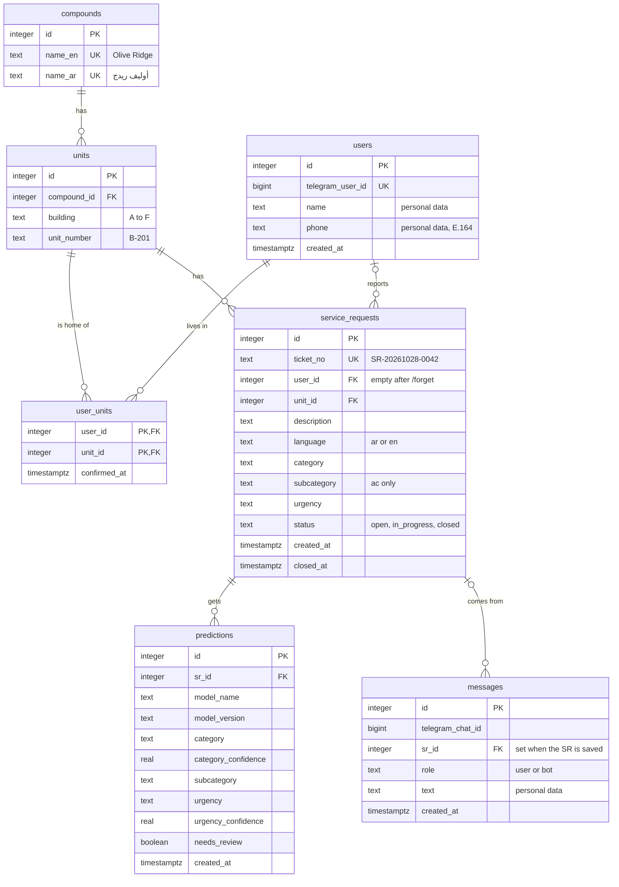

# Design notes

**Version 1 · 2026-10-28 · Step 1.11**

This file is the plan for Phase 2, written before the code. It says what the bot collects (part 1),
how the database stores it (part 2), and what the dashboard needs from it (part 3).
Phase 2 code follows this file. If the code needs a change, change this file in the same commit.

Decisions are logged in `CLAUDE.md` section 13 as "Step 1.11 D1, D2, …".

**Contents**
1. [Required fields](#1-required-fields)
2. [Database sketch](#2-database-sketch)
3. [Dashboard plan](#3-dashboard-plan)
4. [Change log](#change-log)

---

## 1. Required fields

The bot needs 6 fields before it can save a service request (SR):
`compound`, `building`, `unit_number`, `name`, `phone`, `issue_description`.
The brief calls them "unit information (compound, building, unit number), contact details and the
issue description".

### 1.1 Rules for all fields

1. **The LLM finds, the code checks.** The LLM reads the message and copies out what it finds.
   Python code then cleans each value and checks it (registry lookup, phone rule, name rule).
   The LLM never decides alone that a unit exists: it can invent things.
2. **Missing = empty (`null`), never a guess.** If the message doesn't say the building, the
   building is empty and the bot asks. The LLM must not fill it from a "likely" value.
3. **Clean first, then check (normalization).** Before any rule: trim spaces; turn Arabic-Indic
   digits (٠١٢٣٤٥٦٧٨٩) into 0–9; make letters uppercase where the rule says so.
4. **Every value is confirmed.** The summary (LangGraph node `confirm`) shows all 6 fields, and
   the user says yes or edits. Unit info goes into the profile only after this "yes" (section 9).
5. **Name, phone and the description are personal data** (CLAUDE.md section 9): never in logs,
   traces or error messages. Logs may say "phone: invalid (too short)", never the number.

### 1.2 Summary

| Field | Type after cleanup | Stored example | Rule in one line | Asked in group |
|---|---|---|---|---|
| `compound` | one of 4 registry names | `Olive Ridge` | must be a registry compound | 2 · unit |
| `building` | one letter `A`–`F` | `B` | must exist in that compound | 2 · unit |
| `unit_number` | text `<letter>-<3 digits>` | `B-201` | (compound, building, unit) must be in the registry | 2 · unit |
| `name` | text | `Sara Mahmoud` | full name: at least 2 words, no digits | 3 · contact |
| `phone` | text, international format | `+201XXXXXXXXX` | `+`, country code, 7–15 digits in total; Egypt: mobile only | 3 · contact |
| `issue_description` | text | `The kitchen sink is leaking.` | describes a maintenance problem; 2+ words; ≤ 1,000 characters | 1 · problem |

Where a value can come from: the user's message (LLM extraction), the saved profile (returning
user, section 1.9), or the answer to a follow-up question.

### 1.3 `compound`

- **Type:** one of the 4 compounds in the registry (`app/db/seed/units.csv`). Stored with its
  English name (`compound_en`); the bot shows it in the user's language.
- **Examples:** "Olive Ridge", "I live in Juniper Bay" · "أوليف ريدج"، "ساكنين في بستان الندى"،
  "كمبوند زهرة اللوز".
- **Validation (D3 A, strict):** after cleanup the name must match one registry compound, in
  English or Arabic, any letter case, with or without "compound / كمبوند". A close spelling
  ("جونيبر بيه", "Juniper Bey") is matched in Phase 3 and then confirmed by the user.
  A compound that is not in the registry is refused.
- **Follow-up (missing):**
  - EN: "Which compound is the unit in? Olive Ridge, Juniper Bay, Bostan El Nada or Zahret El Loz?"
  - AR: "الشقة في أنهي كمبوند؟ أوليف ريدج، جونيبر باي، بستان الندى ولا زهرة اللوز؟"
- **Reply (invalid):**
  - EN: "I can't find this compound. We serve Olive Ridge, Juniper Bay, Bostan El Nada and Zahret El Loz."
  - AR: "مش لاقيين الكمبوند ده. الكمبوندات المتاحة: أوليف ريدج، جونيبر باي، بستان الندى، زهرة اللوز."

### 1.4 `building`

- **Type:** one uppercase letter, `A`–`F`.
- **Examples:** "building B", "bldg C" · "عمارة بي"، "عمارة ب"، "مبنى سي".
- **Cleanup:** Latin letter in any case → uppercase. Spoken letter names → letter:
  "إيه" → A, "بي" → B, "سي" → C, "دي" → D, "إي" → E, "إف" → F.
  Arabic letters after the word "عمارة / مبنى": أ → A, ب → B, ج → C, د → D, هـ → E
  (checked by Momo). و for F is left out on purpose: it also means "and".
  If the unit number has a letter (`B-201`), the building comes from it.
- **Validation:** the letter must exist in that compound. Today: Olive Ridge A–C, Juniper Bay A–C,
  Bostan El Nada A–D, Zahret El Loz A–F (registry, seed 42). If the user gives a building and a
  unit number with a different letter ("building C, unit B-201"), the bot asks which one is right.
- **Follow-up (missing):**
  - EN: "Which building in Olive Ridge? (A, B or C)"
  - AR: "أنهي عمارة في أوليف ريدج؟ (A أو B أو C)"
- **Reply (invalid):**
  - EN: "Olive Ridge has buildings A, B and C only. Which one is it?"
  - AR: "أوليف ريدج فيها عمارات A وB وC بس. أنهي واحدة؟"

### 1.5 `unit_number`

- **Type:** text in the registry format `<building letter>-<floor><apartment>`, e.g. `B-201`
  (building B, floor 2, apartment 01). Pattern: one letter `A`–`F`, a dash, 3 digits.
  It is text, not a number: the letter and the dash are part of it.
- **Examples:** "B-201", "unit b201", "flat 201 in building B" · "شقة ٢٠١ عمارة بي"، "B 201"، "ب٢٠١".
- **Cleanup:** remove spaces; Arabic digits → 0–9; letter → uppercase; add the dash
  (`b201` → `B-201`). Only 3 digits given ("201") + a known building → `B-201`.
- **Validation (D3 A, strict):** the whole triple (compound, building, unit_number) must be one row
  of the registry. The pattern is only a first filter: today floors are 1–6 and apartments 01–04,
  but only the registry decides. Example: B-204 exists in Bostan El Nada and Zahret El Loz,
  not in Olive Ridge.
- **Follow-up (missing):**
  - EN: "What is the unit number? For example B-201."
  - AR: "رقم الشقة كام؟ مثلاً B-201"
- **Reply (invalid):**
  - EN: "I can't find unit B-204 in Olive Ridge. Please check the number."
  - AR: "مش لاقيين شقة B-204 في أوليف ريدج. ممكن مراجعة الرقم؟"

### 1.6 `name`

- **Type:** text, saved as written (an Arabic name stays Arabic; no translation).
- **Examples:** "Sara Mahmoud", "Mona Adel Hassan" · "سارة محمود"، "منى عادل حسن".
  Not enough: "Sara", "سارة" (one word).
- **Validation (D2 B, full name):** after trimming, at least 2 words; 3–80 characters; only Arabic
  or Latin letters (accents like é are fine), spaces, `-`, `'` and `.`; no digits or emoji.
  Known limit: "عبد الله" alone passes (2 words, one name). We can't check that a name is real:
  checking against real resident records is out of scope (brief).
- **Follow-up (missing or one word):**
  - EN: "What is your full name? At least first and last name, please."
  - AR: "ممكن الاسم ثنائي على الأقل؟"
- **Reply (invalid, e.g. has digits):**
  - EN: "Please send your name in letters only, at least first and last name."
  - AR: "محتاجين الاسم بالحروف بس، ثنائي على الأقل."

### 1.7 `phone`

- **Type:** text in the international format E.164: `+`, country code, number, no spaces.
  Example shapes: `+201XXXXXXXXX` (Egypt), `+447XXXXXXXXX` (UK). Text, not a number: a number
  would lose the `+` and any leading zero, and we never do maths with it.
- **Examples:** "01X XXXX XXXX", "+20 1X XXXX XXXX", "0020 1X XXXX XXXX", "+44 7XXX XXXXXX" ·
  "٠١X XXXX XXXX". (Shapes only; this file never holds a real number.)
- **Cleanup:** remove spaces, dashes, dots and brackets; Arabic digits → 0–9; `00` at the start → `+`.
  No `+` and 11 digits starting with 010, 011, 012 or 015 → Egyptian mobile → `+20` + the number
  without its first 0.
- **Validation (D1 C, any country):**
  1. It must start with `+` after cleanup. A number without `+` that is not an Egyptian mobile
     → the bot asks for the country code.
  2. `+` then 7–15 digits, first digit not 0 (E.164 allows at most 15 digits).
  3. Egypt (`+20`): mobile only: `+20` then `10`, `11`, `12` or `15`, then 8 digits (12 digits
     after the `+`). Egyptian landlines are refused (D1 B was not chosen).
  - Limit: for other countries, rule 2 checks only the shape, not the length that country uses.
    A full per-country check needs the `phonenumbers` library (a new dependency, Apache 2.0):
    decide in Phase 2.
- **Follow-up (missing):**
  - EN: "Which phone number can we call? An Egyptian mobile (01…) or any number with its country code (+…)."
  - AR: "رقم الموبايل للتواصل؟ رقم مصري (01…) أو أي رقم بكود الدولة (+…)."
- **Reply (invalid):**
  - Too short or too long (EN): "This number doesn't look complete. Egyptian mobiles have 11 digits and start with 010, 011, 012 or 015."
  - Same (AR): "الرقم ده مش كامل. الموبايل المصري ١١ رقم ويبدأ بـ 010 أو 011 أو 012 أو 015."
  - No country code (EN): "Please add the country code with +, for example +44…"
  - Same (AR): "محتاجين كود الدولة بـ +، مثلاً +44…"

### 1.8 `issue_description`

- **Type:** text, in the user's language (Arabic or English, as written). For a voice note: the
  part of the transcript about the problem, after the user confirmed the transcript (D11 A).
- **Examples:** "The kitchen sink is leaking under the cabinet.", "The AC is not cooling." ·
  "الحوض اللي في المطبخ بيسرّب مية تحت الدولاب"، "التكييف مش بيبرّد".
  Not enough: "hello", "مرحبا", "عندي مشكلة" (no problem described).
- **Validation:** describes a maintenance problem (the LLM decides this, and the user confirms);
  at least 2 words; at most 1,000 characters. The LLM copies only the problem part, so a name or
  phone in the same message does not end up in the description.
- **Derived from it (not asked):** `language` (`ar` or `en`), later the category and urgency
  (classifier, Phase 2–3).
- **Follow-up (missing):**
  - EN: "What is the problem? You can type it or send a voice note."
  - AR: "إيه المشكلة؟ (كتابة أو فويس نوت)"
- **Reply (not a maintenance problem):**
  - EN: "What needs fixing? For example: a leak, no power, the AC, a door."
  - AR: "إيه اللي محتاج تصليح؟ مثلاً: تسريب مية، الكهربا قاطعة، التكييف، باب."

### 1.9 How the bot asks (D4 B)

**Three groups, in this order, only for what is missing:**
1. **Problem:** `issue_description`.
2. **Unit:** `compound`, `building`, `unit_number`. People say them together ("Olive Ridge, B-201"),
   so the bot asks for all missing ones in one message. If all three are missing:
   - EN: "Which unit is this for? We need the compound, building and unit number, e.g. Olive Ridge, B-201."
   - AR: "الطلب ده لأنهي شقة؟ محتاجين اسم الكمبوند والعمارة ورقم الشقة، مثلاً: أوليف ريدج، B-201"
3. **Contact:** `name`, `phone`. If both are missing:
   - EN: "What is your full name, and which phone number can we call?"
   - AR: "محتاجين الاسم ثنائي على الأقل ورقم موبايل للتواصل."

If the user answers only part of a group, the bot asks again for the rest (the `ask_missing` →
`extract` loop). The bot replies in the language of the user's last message. The Arabic questions
avoid "you" verbs (male and female forms differ) and use "we need" (محتاجين) instead.

**Returning users** (known Telegram user ID, profile in Postgres):
- Name and phone come from the profile; the bot does not ask them, and the summary shows them.
- One saved unit → "Is this for unit B-201 in Olive Ridge?" (yes / no). More than one → the bot
  lists them. "No" or a new unit → group 2, and the new unit is saved after the summary "yes".

**Too many wrong answers:** after 3 invalid answers in a row for the same field, the bot shows the
format once more and mentions `/reset`. (Proposed; tune in Phase 3.)

### 1.10 Example: what the extraction returns

Example data, not code. The user wrote "التكييف مش بيبرّد، عمارة بي في أوليف ريدج".
The LLM returns what it found; `null` = not found:

```json
{
  "compound": "أوليف ريدج",
  "building": "بي",
  "unit_number": null,
  "name": null,
  "phone": null,
  "issue_description": "التكييف مش بيبرّد"
}
```

After cleanup and checks: compound `Olive Ridge` ✓, building `B` ✓ (exists in Olive Ridge),
issue ✓. Missing: `unit_number` (group 2), `name` and `phone` (group 3). The bot asks
"رقم الشقة كام؟ مثلاً B-201" first, then the contact group.

**Link to the success criteria:** a test conversation "captures all required unit fields" (target
≥ 90%, Phase 4) when compound, building and unit_number after cleanup equal the expected values.

---

## 2. Database sketch

The PostgreSQL tables for Phase 2 (SQLAlchemy models + Alembic migrations). It starts from
CLAUDE.md section 7 and adds decisions D5–D8 (section 2.9 lists what changed).
Redis (session state and recent turns) is not here: see CLAUDE.md section 8.

### 2.1 Diagram

How to read the lines: `||` = exactly one, `|o` = zero or one, `o{` = zero or more.
`PK` = primary key, `FK` = foreign key, `UK` = unique.



GitHub draws this diagram. VS Code's built-in preview shows it as text only.

### 2.2 Tables

Every table has `id` as its primary key: a number Postgres gives each new row (an identity
column). It never changes and is never reused. Rules in the "Rule" column are enforced by the
database itself (constraints), so wrong data can't get in even if the Python code has a bug.

**`compounds`**: the 4 compounds of the registry (D6 B). Loaded from `units.csv`.

| Column | Type | Rule | Meaning |
|---|---|---|---|
| `id` | integer | PK | |
| `name_en` | text | NOT NULL, UNIQUE | `Olive Ridge` |
| `name_ar` | text | NOT NULL, UNIQUE | `أوليف ريدج` |

**`units`**: the 188 units of the registry (`app/db/seed/units.csv`). Read-only for the bot.

| Column | Type | Rule | Meaning |
|---|---|---|---|
| `id` | integer | PK | |
| `compound_id` | integer | NOT NULL, FK → `compounds.id` | which compound |
| `building` | text | NOT NULL, CHECK: one letter `A`–`F` | `B` |
| `unit_number` | text | NOT NULL, CHECK: pattern `A-201` and first letter = `building` | `B-201` |

UNIQUE (`compound_id`, `unit_number`). `unit_number` alone is not unique: B-204 exists in two
compounds. Section 7 said unique(compound, building, unit_number); because the CHECK ties the
letter to `building`, the pair is enough and means the same.

**`users`**: the profile. One row per resident who has confirmed at least one SR. The row is made
at the first "yes" in the summary, not at `/start`, so people who only say hello are not stored.

| Column | Type | Rule | Meaning |
|---|---|---|---|
| `id` | integer | PK | |
| `telegram_user_id` | bigint | NOT NULL, UNIQUE | how a returning user is recognized |
| `name` | text | NOT NULL | full name (D2 B); personal data |
| `phone` | text | NOT NULL, CHECK: `+` then 7–15 digits | E.164, e.g. `+201XXXXXXXXX` (D1 C); personal data |
| `created_at` | timestamptz | NOT NULL, default now | first confirmed SR |

The phone CHECK is a second safety net: Python checks the full rule (section 1.7) first; the
database refuses at least anything that is not E.164-shaped.

The brief's profile also has "registered units" and "past SR IDs". They are not columns here:
they come from `user_units` and from `service_requests.user_id` (section 2.5).

**`user_units`**: which user lives in which unit (many-to-many, section 2.4).

| Column | Type | Rule | Meaning |
|---|---|---|---|
| `user_id` | integer | PK (part 1), FK → `users.id`, ON DELETE CASCADE | |
| `unit_id` | integer | PK (part 2), FK → `units.id` | |
| `confirmed_at` | timestamptz | NOT NULL | when the user said "yes" to this unit |

The primary key is the pair (`user_id`, `unit_id`): a composite key. The same link can't be saved twice.

**`service_requests`**: one row per confirmed SR. The dashboard reads mostly this table.

| Column | Type | Rule | Meaning |
|---|---|---|---|
| `id` | integer | PK, identity **BY DEFAULT** (section 2.6) | also the number inside the ticket |
| `ticket_no` | text | NOT NULL, UNIQUE | `SR-20261028-0042` (D5 B, section 2.6) |
| `user_id` | integer | FK → `users.id`, NULL allowed, ON DELETE SET NULL | empty after `/forget` (D8 C) |
| `unit_id` | integer | NOT NULL, FK → `units.id` | always a real unit (D3 A) |
| `description` | text | NOT NULL | the problem, user's language; `[deleted]` after `/forget` |
| `language` | text | NOT NULL, CHECK: `ar`, `en` | |
| `category` | text | NOT NULL, CHECK: the 8 categories | final category |
| `subcategory` | text | NULL allowed, CHECK: only for `ac`: `cooling`, `heating`, `ventilation` | Step 1.8 |
| `urgency` | text | NOT NULL, CHECK: `low`, `medium`, `high` | final urgency |
| `status` | text | NOT NULL, default `open`, CHECK: `open`, `in_progress`, `closed` | |
| `created_at` | timestamptz | NOT NULL, default now | when the user confirmed |
| `closed_at` | timestamptz | NULL until closed; CHECK: set only when `status` = `closed`, and ≥ `created_at` | for the handling time |

**`predictions`**: every model answer for an SR (D7 A). One row per SR per model run.

| Column | Type | Rule | Meaning |
|---|---|---|---|
| `id` | integer | PK | |
| `sr_id` | integer | NOT NULL, FK → `service_requests.id`, ON DELETE CASCADE | |
| `model_name` | text | NOT NULL | e.g. `tfidf_logreg` |
| `model_version` | text | NOT NULL | e.g. `1.0.0` |
| `category` | text | NOT NULL, CHECK: the 8 categories | |
| `category_confidence` | real | NOT NULL, CHECK: 0–1 | |
| `subcategory` | text | NULL allowed (same CHECK as above) | |
| `urgency` | text | NOT NULL, CHECK: 3 levels | |
| `urgency_confidence` | real | NOT NULL, CHECK: 0–1 | |
| `needs_review` | boolean | NOT NULL | true if either confidence is below the threshold (set in Phase 4) |
| `created_at` | timestamptz | NOT NULL, default now | |

UNIQUE (`sr_id`, `model_name`, `model_version`): the same model version can't answer twice for
one SR. The Phase 4 ML-vs-LLM comparison runs on the test set, not on saved SRs, so it doesn't
need this table.

**`messages`**: the conversation history kept in Postgres (the brief: the database stores
"conversation history"). The short-term copy for the LLM lives in Redis.

| Column | Type | Rule | Meaning |
|---|---|---|---|
| `id` | integer | PK | |
| `telegram_chat_id` | bigint | NOT NULL | in a private chat = the user's Telegram ID |
| `sr_id` | integer | FK → `service_requests.id`, NULL allowed, ON DELETE CASCADE | filled when the SR is saved |
| `role` | text | NOT NULL, CHECK: `user`, `bot` | who wrote it |
| `text` | text | NOT NULL | personal data; for a voice note, the confirmed transcript (audio is never stored) |
| `created_at` | timestamptz | NOT NULL, default now | |

No `user_id` here: the first messages arrive before a profile exists. `/forget` finds them by
`telegram_chat_id`. How long messages of unfinished conversations are kept is still open
(CLAUDE.md section 14).

### 2.3 Relationships

| Relationship | Kind | Where the FK is | In words |
|---|---|---|---|
| compounds → units | one-to-many | `units.compound_id` | a compound has many units; a unit is in one compound |
| units → service_requests | one-to-many | `service_requests.unit_id` | a unit has many SRs; an SR is for exactly one unit |
| users → service_requests | one-to-many (optional) | `service_requests.user_id` | a user has many SRs; an SR has one user, or none after `/forget` |
| service_requests → predictions | one-to-many | `predictions.sr_id` | an SR can get answers from several models (v1, v2) |
| service_requests → messages | one-to-many (optional) | `messages.sr_id` | an SR comes from many messages; a message may belong to no SR |
| users ↔ units | **many-to-many** | both FKs in `user_units` | a user can have several units; a unit can have several users |

**Rule of thumb:** in a one-to-many relationship, the FK always sits on the "many" side
(each SR stores its one `unit_id`; a unit doesn't store a list of SRs).

### 2.4 Why `user_units` is a separate table

A user can have two flats (an owner), and a flat can have two users (a husband and a wife both
report problems). Where could the link go?

- **A list of units in `users`** (`units = "B-201, C-302"`): a cell must hold one value (first
  normal form). The database can't check each item, and "who lives in B-201?" means searching
  inside text.
- **`user_id` in `units`**: a unit could have only one user. The second resident would overwrite the first.
- **A join table `user_units`**, one row per (user, unit) pair: both FKs are checked by the
  database, each link is one row, and adding or removing a link touches one row only.

The join table also holds facts that belong to the **pair**, not to the user or the unit alone:
`confirmed_at` is when *this* user confirmed *this* unit (the brief: unit info is saved only after
the user confirms it). This is where the bot finds "Is this for unit B-201?".

### 2.5 Normalization: each fact in one place

**Stored once:**
- A compound's names are in `compounds`, once (D6 B). In the CSV, "أوليف ريدج" is repeated on 30
  rows; one wrong edit would make two spellings (an update anomaly). Now the UNIQUE rule blocks it.
- "Past SR IDs" and "registered units" (brief, user profile) are not stored as lists in `users`.
  A query finds them (`SELECT ticket_no FROM service_requests WHERE user_id = …`), so they can
  never disagree with the real rows.

**Copies kept on purpose (denormalization), each with a reason:**
- `units.building` repeats the letter inside `unit_number`. Kept so the dashboard can group by
  building easily; the CHECK makes sure the two never disagree.
- `service_requests.category / urgency / subcategory` look like a copy of a prediction, but they
  mean something else: the **final** answer. Predictions are what each model *said*; a person may
  later correct the SR, or model v2 may disagree. Keeping both lets us measure the models.
- `ticket_no` can be computed from `id` and `created_at`, but it is stored (UNIQUE): `/status`
  finds it quickly, and an old ticket keeps its number even if the format changes one day.

### 2.6 Ticket number (D5 B)

Format: `SR-YYYYMMDD-NNNN`, e.g. `SR-20261028-0042`.
- `YYYYMMDD` = the date of `created_at` in Cairo time (time zone `Africa/Cairo`, which has summer
  time again since 2023, so never a fixed "+2").
- `NNNN` = the SR's `id`, with zeros in front up to 4 digits. It does not restart each day;
  after 9999 it simply gets longer (`SR-20271231-10342`).
- Made in one statement: take the next `id` from the database sequence, build the ticket,
  insert the row with that `id`. Two SRs saved at the same moment get different `id`s, so they
  can't get the same ticket (no race condition).
- So `service_requests.id` is an identity column **BY DEFAULT**: the app may supply the `id` it
  took. With `GENERATED ALWAYS` (the other tables), Postgres refuses a supplied `id` (tested in C1).
- Pad the number in Python: `f"{id:04d}"` gives `0042` and leaves `10342` whole. In SQL, plain
  `lpad(id::text, 4, '0')` **cuts** `10342` to `1034`; use
  `lpad(id::text, greatest(4, length(id::text)), '0')` (tested in C1).
- Numbers can skip: an insert that fails (e.g. a CHECK refuses it) has already used its `id`,
  and a sequence never gives a number back. `SR-…-0006` may be followed by `SR-…-0009`. That is
  normal and harmless.
- `/status` accepts small letters, spaces and Arabic digits (`/status sr ٢٠٢٦١٠٢٨ ٤٢` works after
  cleanup). It shows an SR only if the SR's `user_id` is the asking user's. For someone else's
  ticket it answers "not found", the same as for a ticket that doesn't exist, so it doesn't
  reveal that the ticket exists.

### 2.7 What `/forget` deletes (D8 C)

The bot first shows what will be deleted and asks "yes / no". If the user has an open SR, it says
that we can't call them about it afterwards. On "yes", in one transaction, in this order:

1. `service_requests.description` → `[deleted]` for every SR of this user. This must come first:
   after step 3 we can't find "this user's SRs" any more.
2. Delete all `messages` with this `telegram_chat_id` (also when there is no profile yet).
3. Delete the `users` row. The database then removes the `user_units` rows (ON DELETE CASCADE)
   and empties `service_requests.user_id` (ON DELETE SET NULL).
4. Delete the Redis keys `session:{chat_id}` and `history:{chat_id}`.

**Kept:** each SR's unit, category, subcategory, urgency, status and dates, and its predictions.
None of them contains the person's name, phone or words, so the dashboard numbers stay right.
Known limit: in a real compound a unit identifies a household; here the units are fictional.

**ON DELETE rules for every FK:**

| FK | When the parent row is deleted | Why |
|---|---|---|
| `units.compound_id` | refused (RESTRICT, the default) | a compound with units is never deleted |
| `user_units.user_id` | CASCADE (delete the link) | `/forget` |
| `user_units.unit_id` | refused | registry units are not deleted |
| `service_requests.user_id` | SET NULL | `/forget` keeps the SR (D8 C) |
| `service_requests.unit_id` | refused | |
| `predictions.sr_id` | CASCADE | a prediction means nothing without its SR |
| `messages.sr_id` | CASCADE | same |

SRs themselves are never deleted by the bot; CASCADE matters only for manual clean-ups and tests.

### 2.8 Types and conventions

- **Time:** every time column is `timestamptz`, saved as UTC. Metabase and the bot show Cairo time.
- **Labels as `text` + CHECK**, not Postgres ENUM types. Adding a 9th category later = change one
  CHECK in a migration. Changing an ENUM is harder.
- **Telegram IDs are `bigint`:** they can be bigger than an `integer` holds (about 2.1 billion).
- **Phone and unit numbers are `text`:** they have `+`, letters and leading zeros.
- **Indexes:** Postgres makes an index for each PK and UNIQUE rule by itself, but **not** for FKs.
  Add: `service_requests (created_at)` (charts by date), `service_requests (user_id)`
  (`/status`, `/forget`), `service_requests (unit_id)`, `messages (telegram_chat_id)` (`/forget`).
  Not needed: `predictions (sr_id)`. The UNIQUE (`sr_id`, `model_name`, `model_version`) index
  starts with `sr_id`, and an index on several columns also serves searches on its first column.
- **Names:** tables in plural snake_case (`service_requests`), FKs as `<table in singular>_id`.

### 2.9 Changes from CLAUDE.md section 7

| Table | Change | Why |
|---|---|---|
| `compounds` | new table | D6 B: each compound name stored once |
| `units` | `compound` → `compound_id` (FK); UNIQUE (`compound_id`, `unit_number`); CHECK first letter = `building` | D6 B; section 2.2 |
| `users` | `phone` in E.164 | D1 C |
| `service_requests` | `user_id` may be empty; new column `subcategory`; CHECK rules on all labels | D8 C; Step 1.8 |
| `predictions` | `confidence` → `category_confidence` + `urgency_confidence`; new column `subcategory`; UNIQUE (sr_id, model_name, model_version) | D7 A |
| `messages` | `role` = `user` / `bot` | made concrete |
| all | types, ON DELETE rules, indexes | sections 2.7 and 2.8 |

---

## 3. Dashboard plan

Metabase reads Postgres directly (brief). The brief asks for 5 charts: SR volume over time,
category and urgency breakdown, top units and buildings, open vs closed, average handling time.
For each: the question it answers, the chart type, the tables and columns, the SQL idea, and
what we must store. The SQL ideas are sketches for Metabase "native questions"; most of them
can also be clicked together in Metabase's query builder.

### 3.1 What Metabase can read (D10 A)

Metabase gets its own Postgres user, `metabase_reader`, with read rights only (SELECT).
It can read `compounds`, `units`, `predictions` and one view. It can't read `users`, `messages`,
`user_units` or the `service_requests` table itself, so names, phones and message texts can
never appear on the dashboard.

A **view** is a saved query that looks like a table. This one is `service_requests` without
`description` and `user_id`:

```sql
CREATE VIEW dashboard_service_requests AS
SELECT id, ticket_no, unit_id, language, category, subcategory, urgency,
       status, created_at, closed_at
FROM service_requests;

GRANT SELECT ON compounds, units, predictions, dashboard_service_requests TO metabase_reader;
```

A view runs with the rights of its owner (the app's user), so `metabase_reader` can read the
view without any right on `service_requests`. A new column in `service_requests` does not
appear in the view until a migration adds it there too.

Metabase setting: report time zone `Africa/Cairo`, so "today" and every day on a chart are Cairo days.

### 3.2 Chart 1: SR volume over time

- **Question:** how many SRs come in per day (or week)?
- **Chart:** line or bar; x = day, y = number of SRs; filter by date range.
- **Reads:** `dashboard_service_requests.created_at`.
- **SQL idea:**
  ```sql
  SELECT (created_at AT TIME ZONE 'Africa/Cairo')::date AS day, count(*) AS srs
  FROM dashboard_service_requests
  GROUP BY day
  ORDER BY day;
  ```
  Per week: `date_trunc('week', created_at AT TIME ZONE 'Africa/Cairo')`. A day with 0 SRs has
  no row; to show the zeros, start from `generate_series` of all days (as in chart 4).
- **Must store:** `created_at` on every SR, set by the database when the user confirms
  (NOT NULL, default now). It is never changed afterwards.

### 3.3 Chart 2: category and urgency breakdown

- **Question:** which problems come in most, and how urgent are they?
- **Chart:** stacked bar: one bar per category, coloured by urgency. Plus a small table of
  `ac` sub-labels (heating, ventilation, cooling).
- **Reads:** `dashboard_service_requests.category`, `urgency`, `subcategory`.
- **SQL idea:**
  ```sql
  SELECT category, urgency, count(*) AS srs
  FROM dashboard_service_requests
  GROUP BY category, urgency
  ORDER BY category, urgency;
  ```
- **Must store:** the **final** category and urgency on the SR itself, not only in `predictions`.
  The CHECK rules keep the labels clean: without them, "ac" and "AC" would make two bars.

### 3.4 Chart 3: top units and buildings

- **Question:** which units and buildings report the most problems?
- **Chart:** horizontal bar, top 10 units; a second one for buildings.
- **Reads:** `dashboard_service_requests.unit_id` → `units.unit_number`, `units.building` →
  `compounds.name_en`.
- **SQL idea:**
  ```sql
  SELECT c.name_en AS compound, u.unit_number, count(*) AS srs
  FROM dashboard_service_requests s
  JOIN units u ON u.id = s.unit_id
  JOIN compounds c ON c.id = u.compound_id
  GROUP BY c.name_en, u.unit_number
  ORDER BY srs DESC, compound, u.unit_number
  LIMIT 10;
  ```
  Buildings: the same, with `u.building` instead of `u.unit_number`.
  Always group by the compound too: building B exists in all 4 compounds, and B-204 in two.
  Without the compound, different places would be counted as one.
- **Must store:** `unit_id` on every SR (NOT NULL, D3 A). With the lenient option (D3 B), there
  would be an "unknown unit" bar.

### 3.5 Chart 4: open vs closed

- **Question:** how many SRs are still open, and is the open pile growing?
- **Chart:** number cards (open, in progress, closed) for today, and a line of open SRs per day.
- **Reads:** `dashboard_service_requests.status`, `created_at`, `closed_at`.
- **SQL idea, today:**
  ```sql
  SELECT status, count(*) AS srs
  FROM dashboard_service_requests
  GROUP BY status;
  ```
- **SQL idea, over time** (D9 A is enough): an SR was not closed at the end of day *d* if it
  was created on or before *d* (Cairo date) and not closed on or before *d*.
  "Not closed" = `open` + `in_progress`.
  ```sql
  WITH days AS (
    SELECT g::date AS day
    FROM generate_series(date '2026-11-01', current_date, interval '1 day') AS g
  )
  SELECT days.day, count(s.id) AS not_closed
  FROM days
  LEFT JOIN dashboard_service_requests s
    ON (s.created_at AT TIME ZONE 'Africa/Cairo')::date <= days.day
   AND (s.closed_at IS NULL OR (s.closed_at AT TIME ZONE 'Africa/Cairo')::date > days.day)
  GROUP BY days.day
  ORDER BY days.day;
  ```
  (`2026-11-01` stands for the first day with data.) `generate_series` makes one row per day;
  `LEFT JOIN` keeps the days with 0.
- **Must store:** `status` (CHECK: 3 values) and `closed_at`, set at the moment the SR is closed.
  Limit of D9 A: if an SR is closed, then reopened, the old close time is lost.

### 3.6 Chart 5: average handling time

- **Question:** how long does it take from the report to the fix?
- **Chart:** number card (all closed SRs) and a bar per category, in hours.
- **Reads:** `dashboard_service_requests.created_at`, `closed_at`, `status`, `category`.
- **SQL idea:**
  ```sql
  SELECT category,
         count(*) AS closed_srs,
         round((extract(epoch FROM avg(closed_at - created_at)) / 3600)::numeric, 1)
           AS avg_hours,
         round((extract(epoch FROM percentile_cont(0.5)
                WITHIN GROUP (ORDER BY closed_at - created_at)) / 3600)::numeric, 1)
           AS median_hours
  FROM dashboard_service_requests
  WHERE status = 'closed'
  GROUP BY category
  ORDER BY category;
  ```
  `closed_at - created_at` is a time span (`interval`); `extract(epoch …) / 3600` turns it into hours.
  Show the **median** next to the average: one SR that stayed open for a month pulls the average
  up a lot, but barely moves the median.
- **Must store:** `closed_at`, written at the moment of closing and never filled in later
  (a guessed `closed_at` makes the chart wrong).
- **Limit:** only closed SRs count. SRs that are still open and very old are not in the number,
  so the average looks better than it is. Show it next to chart 4.

### 3.7 What we must store: summary

| Must store | Where | Charts | Without it |
|---|---|---|---|
| `created_at`, NOT NULL, set by the database | `service_requests` | 1, 4, 5 | no time axis at all |
| `closed_at`, set at the moment of closing | `service_requests` | 4, 5 | no handling time; can't add it later for old SRs |
| `status` with CHECK | `service_requests` | 4, 5 | typos split the counts |
| final `category`, `urgency`, `subcategory` with CHECK | `service_requests` | 2, 5 | only model guesses, and messy labels |
| `unit_id` NOT NULL → `units` → `compounds` | `service_requests`, `units`, `compounds` | 3 | "unknown unit" bar; buildings of different compounds mixed |
| Cairo time zone when grouping by day | every query; Metabase setting | 1, 4 | SRs near midnight land on the wrong day |

This is the main reason to design before coding: a column added in Phase 4 has no value for all
the SRs saved before it.

### 3.8 Data for the charts

- Phase 2: Metabase on a few fake rows (CLAUDE.md section 12, Phase 2).
- Phase 3: real SRs from the bot.
- Nobody closes SRs in this project (technicians and scheduling are out of scope). Charts 4 and 5
  need closed SRs, so a small script will close some demo SRs with made-up times (Phase 4 or 6).
  The demo must say that these times are invented. Who changes a status, and how, is open
  (CLAUDE.md section 14).

### 3.9 Ideas outside the brief (for the stretch list, Step 1.12)

- Share of SRs flagged `needs_review` (stored in `predictions`).
- Arabic vs English SRs (`language` is stored).
- Voice vs text SRs: **not stored**. If we want it, a `source` column must exist from the first SR.
- Time until work starts (D9 B) and full status history (D9 C).

---

## Change log

| Version | Date | Change |
|---|---|---|
| 1 | 2026-10-28 | First version, Step 1.11: required fields (D1–D4), database sketch (D5–D8), dashboard plan (D9–D10). Check C1 in the local Postgres 16.15, inside one transaction that ended with ROLLBACK (nothing kept): the 7 tables + view + role created; all 188 registry units loaded; 20 bad inserts all refused; the 5 chart queries run as `metabase_reader` gave the answers worked out by hand; `users`, `messages`, `service_requests` denied to it; `/forget` in the order of 2.7 left 6 SRs on the dashboard. C1 found 4 changes, made here: identity BY DEFAULT for `service_requests.id`, the `lpad` trap, numbers can skip, no `predictions (sr_id)` index; plus the phone CHECK. |
